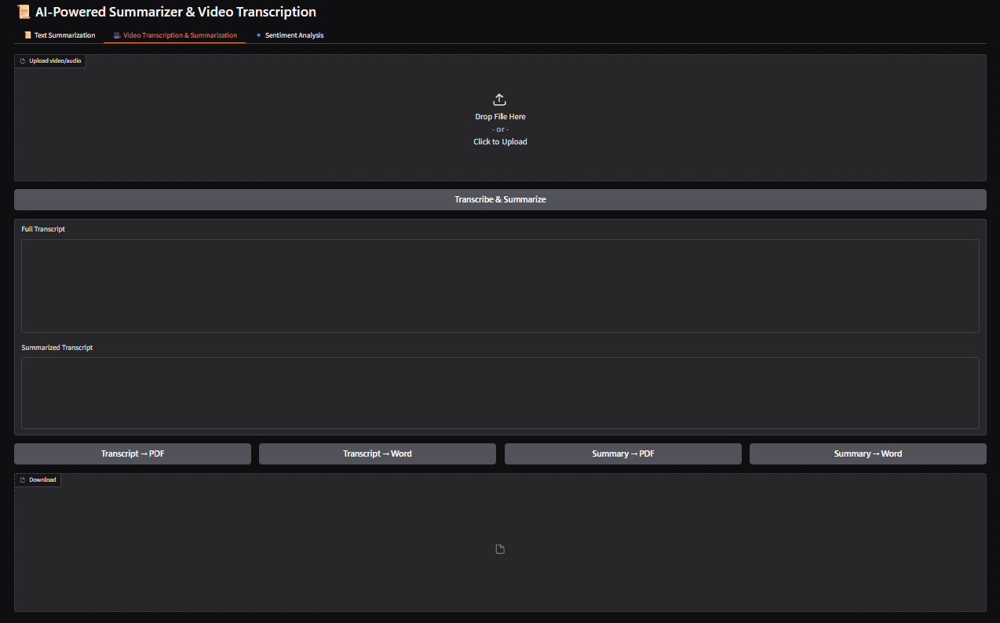
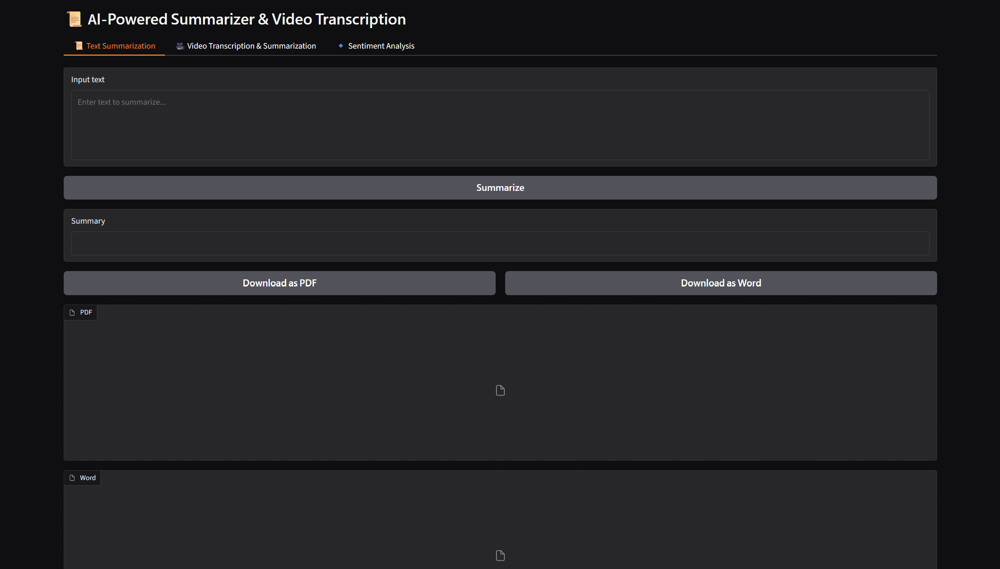
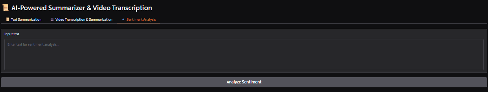

# 🎥 AI Video Transcriber & Summarizer

A Gradio web app that transcribes videos, summarizes text and transcripts, runs sentiment analysis, and exports results as PDF or Word files. Everything runs locally on your machine.
## Screenshots

### Video transcription & summarization


### Text summarization


### Sentiment analysis

## Features

- **Video transcription** – speech-to-text with [OpenAI Whisper](https://github.com/openai/whisper)
- **Summarization** – T5 summarizer (`t5-base` on CPU, `t5-large` on GPU) that handles long transcripts by chunking
- **Sentiment analysis** – positive/negative classification with confidence score (DistilBERT)
- **Export** – download transcripts or summaries as **PDF** or **Word (.docx)**
- Uses GPU automatically when CUDA is available, otherwise CPU

## Requirements

- Python 3.9+
- [FFmpeg](https://ffmpeg.org/download.html) installed and on your PATH
  - Ubuntu/Debian: `sudo apt install ffmpeg`
  - macOS: `brew install ffmpeg`
  - Windows: `choco install ffmpeg` (or download from ffmpeg.org)
- ~8 GB RAM recommended (a GPU is much faster)

## Project structure

```
.
├── app.py             # Main Gradio application
├── requirements.txt   # Python dependencies
├── README.md
├── LICENSE
├── .gitignore         # Files Git should not track
└── .vscode/
    └── launch.json   # Press F5 to run in VS Code
├── screenshots/       # Images used in this README
```

## Run locally in VS Code

1. **Install prerequisites**: [Python 3.9–3.12](https://www.python.org/downloads/) (tick "Add to PATH" on Windows), [VS Code](https://code.visualstudio.com/) with the *Python* extension, and FFmpeg.
   - Windows: `winget install Gyan.FFmpeg` (then restart VS Code)
   - macOS: `brew install ffmpeg` / Ubuntu: `sudo apt install ffmpeg`
2. **Open the project folder**: *File → Open Folder…*
3. **Open a terminal** in VS Code (`Ctrl+` `` ` ``) and create a virtual environment:
   ```bash
   python -m venv venv
   venv\Scripts\activate          # Windows (PowerShell/CMD)
   source venv/bin/activate        # macOS / Linux
   ```
   If PowerShell blocks activation, run once: `Set-ExecutionPolicy -Scope CurrentUser RemoteSigned`
4. **Select the interpreter**: `Ctrl+Shift+P` → *Python: Select Interpreter* → choose the `venv` one.
5. **Install dependencies**:
   ```bash
   pip install -r requirements.txt
   ```
   NVIDIA GPU? Install the CUDA build of PyTorch first from [pytorch.org](https://pytorch.org/get-started/locally/).
6. **Run**: press `F5` (choose *Run app.py*) or run `python app.py`. Your browser opens at http://127.0.0.1:7860.

The first run downloads the models (can be several GB), so it takes a while.

### Configuration (optional)

| Variable | Default | Description |
|---|---|---|
| `WHISPER_MODEL` | `base` on CPU, `medium` on GPU | `tiny`, `base`, `small`, `medium`, `large` |
| `T5_MODEL` | `t5-base` on CPU, `t5-large` on GPU | Use `t5-base` for lower memory |
| `GRADIO_SHARE` | unset | Set to `1` for a temporary public link |

Example for low-resource machines:

```powershell
$env:WHISPER_MODEL="tiny"; $env:T5_MODEL="t5-base"; python app.py   # Windows PowerShell
```
```bash
WHISPER_MODEL=tiny T5_MODEL=t5-base python app.py                   # macOS / Linux
```

## Privacy

Transcription, summarization and sentiment analysis all run on your own machine. Your videos and text are not sent to any server. The only network use is the one-time model download, plus the optional public link if you enable `GRADIO_SHARE=1`.

## Notes

- Models are downloaded automatically on first run (several GB in total).
- Summaries come from a general-purpose T5 model and may miss details; check important results.
- PDF export supports Latin characters only; use the Word export for other languages.

## License

MIT, see [LICENSE](LICENSE).
